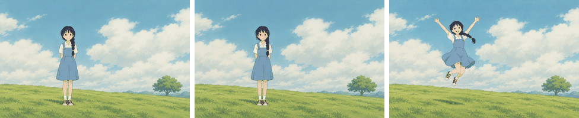
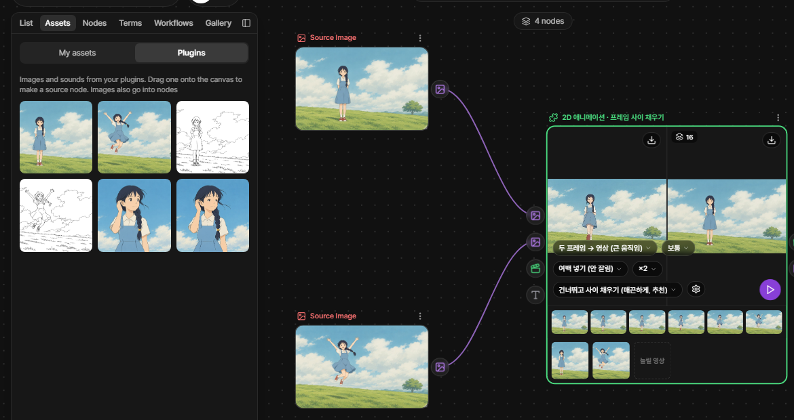
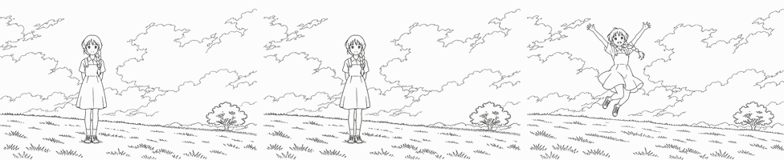
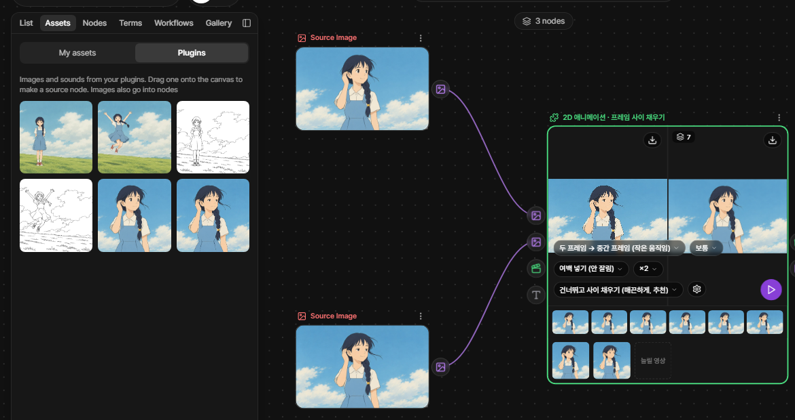
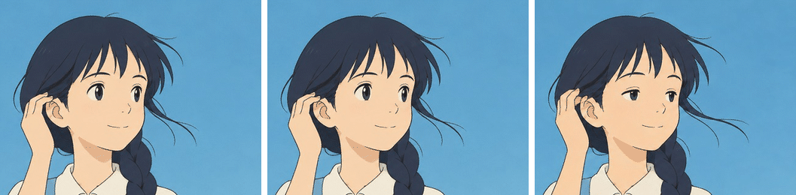
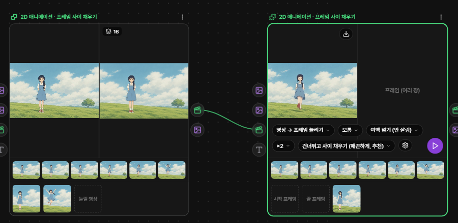
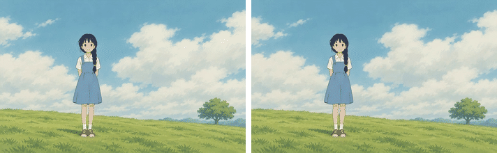

# 2D Animation Pack — Fill Between Frames (ToonCrafter · AnimeInterp)

[한국어](README.md)

A PromBoard community plugin. Give it two drawings (a start frame and an end frame) and it fills in the frames between them to make a short 2D animation; give it an existing anime clip and it adds frames so the motion looks smoother. It adds one node, **2D 애니메이션 · 프레임 사이 채우기** (the plugin's on-screen text is Korean), and you pick one of three modes with the node's mode pill.

Left is the start frame, right is the end frame, and the middle is the result of "two frames → video" (512×320, 16 frames, 2 seconds).

- The 2D Animation Pack is split into three plugins: **Fill Between Frames** (this one) · [Line-art Colorization](https://github.com/promboard-app/anime2d-colorize) · [Colored Video from Keyframes](https://github.com/promboard-app/anime2d-tooncomposer).
- Windows and Linux only (no macOS). "Two frames → video" needs an NVIDIA graphics card with 10 GB or more memory. The other two modes also run without a graphics card (slowly).

## Which mode to pick

| When | Mode (label in the app) | Connect |
|---|---|---|
| The pose changes a lot between the two drawings (standing → jumping) | **Two frames → video (big motion)** · 두 프레임 → 영상 | start frame · end frame (+ an English prompt, optional) |
| The two drawings differ only a little (hair or a hand moves) | **Two frames → in-between frames (small motion)** · 두 프레임 → 중간 프레임 — default | start frame · end frame |
| Make an existing anime clip smoother | **Video → more frames** · 영상 → 프레임 늘리기 | the video |

"Two frames → video" draws new motion with AI (takes a minute or two). "In-between frames" only blends the two drawings along their motion (takes seconds). If you feed a big motion to "in-between frames", you get frames where the two drawings overlap.

## Getting started

1. In PromBoard, open the plugin manager → Community → install and turn on **2D 애니메이션 팩 — 프레임 사이 채우기**.
2. Run setup. It downloads only the in-between model (25 MB). The first time you run "two frames → video", the app asks before downloading its 10.5 GB model.
3. In the canvas left panel, open **Workflows → Plugins** and double-click an example workflow to place it.
4. From the **Assets** tab, drag the example cards (names start with "예제 —", "Example —") onto the **source nodes** on the left. Dropping a card on the plugin node itself does not connect it.
5. Press ▷ on the plugin node.

There are two example workflows.

| Workflow | Example cards to drop on the source nodes |
|---|---|
| 컬러 시작 · 끝 → 두 프레임 → 영상 → 프레임 늘리기 (color start · end → video → more frames) | "예제 — 컬러 시작 프레임" · "예제 — 컬러 끝 프레임" (for line art: "예제 — 선화 시작 프레임" · "예제 — 선화 끝 프레임") |
| 이어진 시작 · 끝 → 두 프레임 → 중간 프레임 (close start · end → in-between frames) | "예제 — 이어진 시작 프레임" · "예제 — 이어진 끝 프레임" |

In the first workflow, ▷ on the first node gives the video; ▷ on the second node too gives that video with ×2 frames.

## Results by mode

Every picture here comes from running this repository's `nodes/` code as-is (`docs/scripts/`). Times and memory were measured on an RTX 4070 SUPER (12 GB) · 64 GB RAM · Windows 11 PC.

### Two frames → video (big motion)

Two line drawings give a line-art video (above). The color result is the first picture of this page.

| Input | Download | GPU memory | First run | Next runs |
|---|---|---|---|---|
| start · end frames (color or line art) + prompt (English, optional) | 10.5 GB | about 9 GB (10 GB or more recommended) | about 1–2 min (including 10–50 s model load) | about 50 s |

- The result is a 512×320, 16-frame, 8 fps 2-second video plus those 16 frames. Landscape 16:10 drawings work best. With other ratios, "비율 맞추기 (fit)" → "여백 넣기 (pad)" fits the whole drawing inside 512×320 and cuts the padding back off the result (a portrait drawing gives something like 200×320). "가운데 자르기 (center crop)" fills 512×320.
- If the two drawings have different sizes, the end frame is matched to the start frame (center-cropped if the ratio differs).
- If the result barely moves, set "움직임 크기 (motion)" to large; if it wobbles too much, set it to small. A different seed gives a different motion.

### Two frames → in-between frames (small motion)

Seven in-between frames drawn between two drawings where the hair blows in the wind and the hand moves behind the ear (shown cropped to the face).

| Input | Download | GPU memory | First run | Next runs |
|---|---|---|---|---|
| start · end frames | 25 MB | about 4 GB (also runs without a GPU) | about 7 s (about 50 s without a GPU) | about 5 s |

- The result is n in-between frames ("중간 프레임 수 (count)", default 7) and a 12 fps video of start · in-betweens · end. The size is the input size; a long side over 960 is reduced to 960 (the size the model was trained on).

### Video → more frames

Left is the original (8 fps), right is ×3 (24 fps). Length and speed are the same.

| Input | Download | GPU memory | Time |
|---|---|---|---|
| a video (up to 480 original frames: 20 s at 24 fps, 16 s at 30 fps; 240 frames without a GPU) | 25 MB (same model as in-between) | about 4 GB | a 1080p 24 fps 20 s clip takes about 7 min at ×2, about 12 min at ×3 |

- Length, speed and sound stay the same; only the fps becomes ×2 or ×3.
- 2D anime shows one drawing for 2–3 frames. With "반복 프레임 (repeats)" set to **skip repeats and fill between** (default), held drawings are skipped and the frames between different drawings are filled at their original times, so the motion becomes evenly smooth. **Keep** only fills between neighboring frames and keeps the original choppy feel.
- After the first 8 frames the node estimates the total time (counting from the start of the node, including reading the video and loading the model); if it would exceed 90% of the run limit (15 min with a GPU, 60 min without), it stops right away and tells you.

## Settings

| Setting (label in the app) | Mode | Meaning |
|---|---|---|
| 모드 (mode) | all | see the table above |
| 중간 프레임 수 (count) | in-between | frames between start and end (1–30, default 7) |
| 움직임 크기 (motion) | two frames → video | small · normal · large (ToonCrafter `frame_stride` 20 · 10 · 5) |
| 비율 맞추기 (fit) | two frames → video | pad (nothing cut off, default) · center crop |
| 배수 (factor) | more frames | ×2 · ×3 |
| 반복 프레임 (repeats) | more frames | skip repeats and fill between (smooth, recommended) · keep (original choppiness) |
| 시드 (seed) | two frames → video | -1 gives a different result each time |

If the inputs don't fit the mode (for example only an end frame, or a video together with drawings), the node says what to connect before loading any model.

## Longer · smoother · larger

- **Longer**: "two frames → video" makes 2 seconds at a time. Make several cuts and join them in the render tab (use the previous cut's end frame as the next cut's start frame for a natural join).
- **Smoother**: connect the result video to a "video → more frames" node for ×2 or ×3 (the first example workflow).
- **Larger**: connect the result video to the [SeedVR2](https://github.com/promboard-app/seedvr2) upscale community plugin.

## Can I use it like this? (licenses)

| Plugin · component | License | Commercial use |
|---|---|---|
| **Fill Between Frames (this plugin)** | | |
| ToonCrafter code · model ("two frames → video") | Apache-2.0 ([model](https://huggingface.co/Doubiiu/ToonCrafter/blob/main/LICENSE) · [code](https://github.com/Doubiiu/ToonCrafter/blob/main/LICENSE)) | yes |
| AnimeInterp code ("in-between" · "more frames") | MIT ([original README](https://github.com/lisiyao21/AnimeInterp#license)) | yes |
| AnimeInterp model file | not stated | not confirmed |
| RAFT-based code inside AnimeInterp | [BSD-3-Clause](nodes/animeinterp/models/rfr_model/LICENSE) | yes |
| [Line-art Colorization](https://github.com/promboard-app/anime2d-colorize) | AniDoc etc. — contains non-commercial parts | no (see its README) |
| [Colored Video from Keyframes](https://github.com/promboard-app/anime2d-tooncomposer) | MIT · Apache-2.0 | yes (see its README) |

- The ToonCrafter file this plugin downloads is licensed Apache-2.0 (commercial use allowed). The "non-commercial" note on the base model (DynamiCrafter) card differs from the license file ([DynamiCrafter model card](https://huggingface.co/Doubiiu/DynamiCrafter)).
- The AnimeInterp model file is only published on the authors' Dropbox, which PromBoard cannot download from. The same file is re-uploaded to this repository's [release `weights-animeinterp`](https://github.com/promboard-app/anime2d/releases/tag/weights-animeinterp) (authors: Li Siyao et al., CVPR 2021). The MIT license in the original README covers the code; the model file's license is not stated.
- PromBoard marks any result that passed through the colorization node as "non-commercial".
- This table is guidance, not legal advice. Check the license texts before use.

## Example drawings

The six example drawings in `cards/` were newly drawn by PromBoard with AI (image generation in the OpenAI codex CLI). Public anime datasets and the original repositories' example images can't be redistributed, so they are not included; they were used only as style references.

## Known limits

- "Two frames → video" is fixed at 512×320 and 2 seconds. Larger input drawings still give a result inside 512×320.
- "In-between frames" runs without the paper's SGM (segment-guided matching) step, so it needs no extra dependencies. With large motion the two drawings may overlap — use "two frames → video" for that.
- Skipping repeats may treat a very small change (only the mouth moves) as the same drawing. Use "keep" then. Videos with film grain differ in every frame, so nothing is treated as a repeat.

## Bundled code

Code from [Doubiiu/ToonCrafter](https://github.com/Doubiiu/ToonCrafter) and [lisiyao21/AnimeInterp](https://github.com/lisiyao21/AnimeInterp) is included under `nodes/` with minimal changes (runs without xformers, fits a 12 GB graphics card, etc.). Changes and commits are listed in [NOTICE.md](NOTICE.md).

- Plugin id: `promboard.anime2d`
- Node id: `fill` — inputs `start` · `end` · `video` · `prompt`, outputs `video` · `frames`
