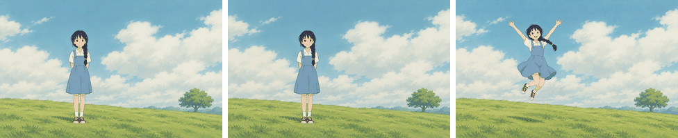
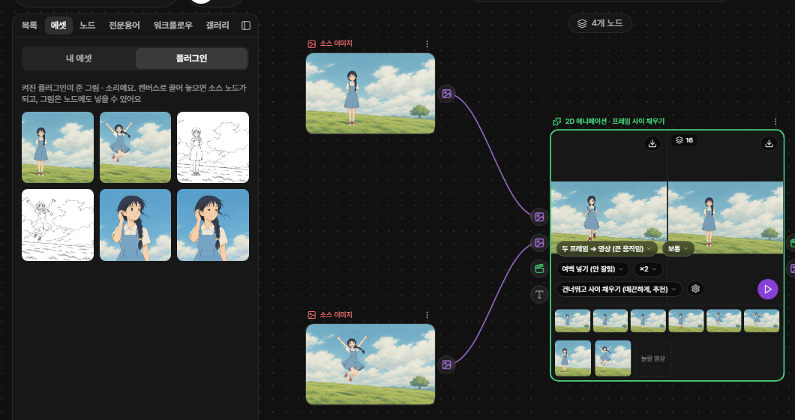
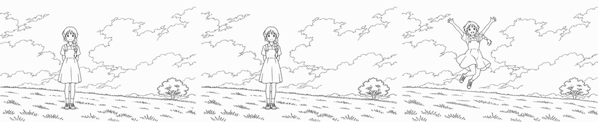
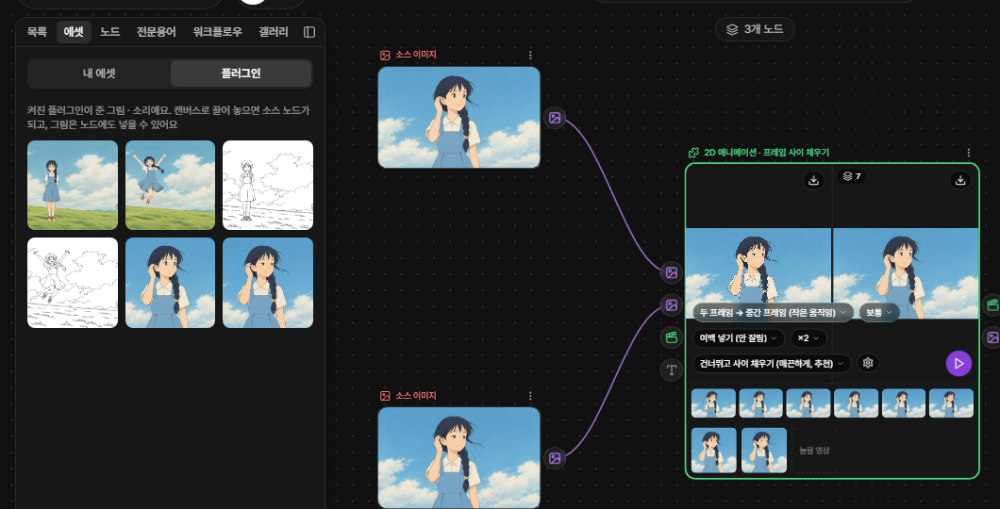
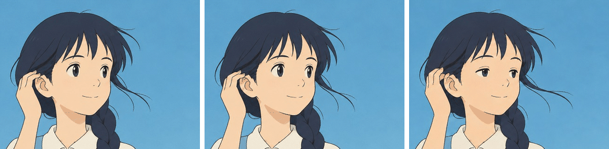
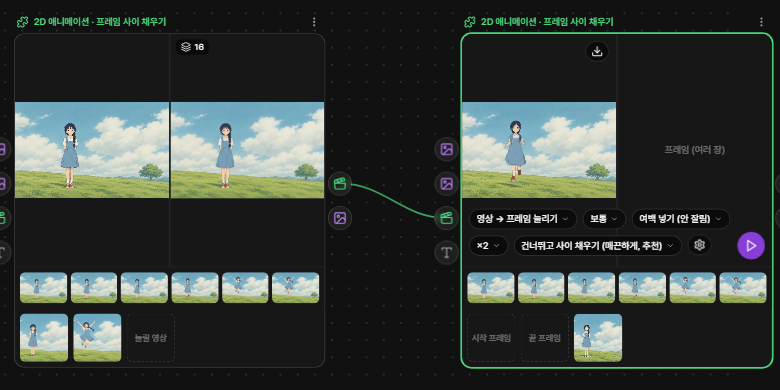
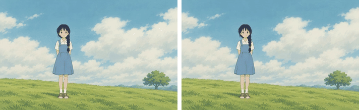

# 2D 애니메이션 팩 — 프레임 사이 채우기 (ToonCrafter · AnimeInterp)

[English](README.en.md)

PromBoard 커뮤니티 플러그인입니다. 그림 두 장(시작 프레임 · 끝 프레임)을 넣으면 그 사이를 채워 짧은 2D 애니메이션을 만들고, 이미 있는 애니 영상은 프레임을 늘려 더 매끄럽게 만듭니다. 캔버스에 **2D 애니메이션 · 프레임 사이 채우기** 노드 하나를 더하고, 노드의 모드 알약으로 셋 중 하나를 고릅니다.

왼쪽이 시작 프레임, 오른쪽이 끝 프레임, 가운데가 '두 프레임 → 영상' 결과(512×320, 16장, 2초)입니다.

- 2D 애니메이션 팩은 세 장으로 나뉩니다: **프레임 사이 채우기**(이 플러그인) · [선화 채색](https://github.com/promboard-app/anime2d-colorize) · [키프레임으로 채색 영상](https://github.com/promboard-app/anime2d-tooncomposer).
- 윈도우 · 리눅스 전용입니다(맥은 안 됩니다). '두 프레임 → 영상'은 NVIDIA 그래픽카드(메모리 10GB 이상)가 있어야 합니다. 나머지 두 모드는 그래픽카드 없이도 돕니다(느립니다).

## 어떤 모드를 고를까

| 이럴 때 | 모드 | 이을 것 |
|---|---|---|
| 자세가 크게 바뀌는 두 장(서 있다가 뛰어오름 등) | **두 프레임 → 영상 (큰 움직임)** | 시작 프레임 · 끝 프레임 (+ 프롬프트, 영어, 넣지 않아도 됨) |
| 살짝만 다른 두 장(머리카락 · 손만 움직임 등) | **두 프레임 → 중간 프레임 (작은 움직임)** — 처음 값 | 시작 프레임 · 끝 프레임 |
| 이미 있는 애니 영상을 더 매끄럽게 | **영상 → 프레임 늘리기** | 늘릴 영상 |

'두 프레임 → 영상'은 AI 가 움직임을 새로 그립니다(몇 분 걸림). '중간 프레임'은 두 장 사이를 이어 그리기만 합니다(몇 초). 큰 움직임을 '중간 프레임'에 넣으면 두 그림이 겹쳐 보이는 프레임이 나옵니다.

## 처음 쓰기

1. PromBoard 의 플러그인 매니저 → 커뮤니티 → **2D 애니메이션 팩 — 프레임 사이 채우기** 를 설치하고 켭니다.
2. 실행 준비를 누르면 '중간 프레임'용 모델(25MB)만 받습니다. '두 프레임 → 영상'을 고르고 처음 실행하면 그때 10.5GB 를 받을지 묻습니다.
3. 캔버스 왼쪽 패널의 **워크플로우 → 플러그인** 탭에서 예제 워크플로우를 두 번 누르면 캔버스에 놓입니다.
4. **에셋** 탭의 예제 카드(이름이 '예제 —'로 시작)를 왼쪽 **소스 노드** 위에 끌어 놓습니다. 플러그인 노드 위에 바로 놓으면 선이 이어지지 않습니다.
5. 플러그인 노드의 ▷ 를 누릅니다.

예제 워크플로우는 둘입니다.

| 워크플로우 | 소스 노드에 놓을 예제 카드 |
|---|---|
| 컬러 시작 · 끝 → 두 프레임 → 영상 → 프레임 늘리기 | '예제 — 컬러 시작 프레임' · '예제 — 컬러 끝 프레임' (선화로 해 보려면 '예제 — 선화 시작 프레임' · '예제 — 선화 끝 프레임') |
| 이어진 시작 · 끝 → 두 프레임 → 중간 프레임 | '예제 — 이어진 시작 프레임' · '예제 — 이어진 끝 프레임' |

첫 워크플로우는 첫 노드만 ▷ 하면 영상, 둘째 노드까지 ▷ 하면 그 영상의 프레임을 ×2 로 늘린 영상이 나옵니다.

## 모드별 결과

그림은 모두 이 저장소의 `nodes/` 코드를 그대로 돌려 얻은 결과입니다(`docs/scripts/`). 시간 · 메모리는 RTX 4070 SUPER(12GB) · RAM 64GB · 윈도우 11 PC 에서 잰 값입니다.

### 두 프레임 → 영상 (큰 움직임)

선화 두 장을 넣으면 선화 영상이 나옵니다(위). 컬러 결과는 맨 위 그림입니다.

| 넣는 것 | 받을 용량 | 그래픽카드 메모리 | 첫 실행 | 다음 실행 |
|---|---|---|---|---|
| 시작 · 끝 프레임(컬러 또는 선화) + 프롬프트(영어, 선택) | 10.5GB | 약 9GB (10GB 이상 권장) | 약 1~2분 (모델 적재 10~50초 포함) | 약 50초 |

- 결과는 512×320, 16장, 8fps 2초 영상과 그 16장입니다. 가로 16:10 그림이 가장 잘 됩니다. 다른 비율은 '비율 맞추기'로 여백을 넣어 다 보이게 넣고 결과에서 여백을 잘라 냅니다(세로 그림이면 200×320 처럼 작아집니다). '가운데 자르기'는 512×320 을 꽉 채웁니다.
- 두 장의 크기가 다르면 끝 프레임을 시작 프레임 크기에 맞춥니다(비율이 다르면 가운데를 잘라서).
- 결과가 거의 안 움직이면 '움직임 크기'를 크게, 너무 출렁이면 작게 바꿉니다. 시드를 바꾸면 다른 움직임이 나옵니다.

### 두 프레임 → 중간 프레임 (작은 움직임)

머리카락이 바람에 날리고 손이 귀 뒤로 가는 두 장 사이에 중간 프레임 7장을 그렸습니다(얼굴 부분만 크게 잘라 보임).

| 넣는 것 | 받을 용량 | 그래픽카드 메모리 | 첫 실행 | 다음 실행 |
|---|---|---|---|---|
| 시작 · 끝 프레임 | 25MB | 약 4GB (그래픽카드 없이도 돎) | 약 7초 (그래픽카드 없이 약 50초) | 약 5초 |

- 결과는 중간 프레임 n장('중간 프레임 수', 처음 값 7)과 시작 · 중간 · 끝을 이은 12fps 영상입니다. 크기는 넣은 그림 그대로이고 긴 변이 960 을 넘으면 960 으로 줄입니다(모델이 배운 크기).

### 영상 → 프레임 늘리기

왼쪽이 원래 영상(8fps), 오른쪽이 ×3 으로 늘린 영상(24fps)입니다. 길이 · 속도는 같습니다.

| 넣는 것 | 받을 용량 | 그래픽카드 메모리 | 걸리는 시간 |
|---|---|---|---|
| 늘릴 영상(20초까지, 그래픽카드 없이 돌면 10초까지) | 25MB ('중간 프레임'과 같은 모델) | 약 4GB | 1080p 24fps 20초를 ×2 하면 약 7분, ×3 은 약 12분 |

- 길이 · 속도 · 소리는 그대로 두고 fps 만 ×2 · ×3 으로 늘립니다.
- 2D 애니는 한 그림을 2~3프레임씩 보여 줍니다. '반복 프레임'을 **건너뛰고 사이 채우기**(처음 값)로 두면 같은 그림이 이어진 곳을 건너뛰고 서로 다른 그림 사이를 원래 시각에 맞춰 채워 움직임이 고르게 매끄러워집니다. **그대로 두기**는 이웃 프레임끼리만 채워 원래 끊기는 느낌이 남습니다.
- 처음 8장을 만든 속도로 전체 시간을 어림해 실행 제한(그래픽카드가 있으면 15분, 없으면 60분)을 넘을 것 같으면 바로 멈추고 알립니다.

## 설정

| 설정 | 쓰는 모드 | 뜻 |
|---|---|---|
| 모드 | 모두 | 위 표 |
| 중간 프레임 수 | 중간 프레임 | 시작과 끝 사이에 넣을 프레임 수(1~30, 처음 값 7) |
| 움직임 크기 | 두 프레임 → 영상 | 작게 · 보통 · 크게 (ToonCrafter `frame_stride` 20 · 10 · 5) |
| 비율 맞추기 | 두 프레임 → 영상 | 여백 넣기(안 잘림, 처음 값) · 가운데 자르기 |
| 배수 | 프레임 늘리기 | ×2 · ×3 |
| 반복 프레임 | 프레임 늘리기 | 건너뛰고 사이 채우기(매끈하게, 추천) · 그대로 두기(원래 끊김 살림) |
| 시드 | 두 프레임 → 영상 | -1 이면 매번 다른 결과 |

모드에 맞지 않게 이으면(예: 끝 프레임만 이음, 영상과 그림을 같이 이음) 모델을 불러오기 전에 무엇을 이어야 하는지 알려 줍니다.

## 더 길게 · 더 매끄럽게 · 더 크게

- **더 길게**: '두 프레임 → 영상'은 한 번에 2초입니다. 여러 컷을 따로 만들어 렌더 탭에서 잇습니다(앞 컷의 끝 프레임을 다음 컷의 시작 프레임으로 쓰면 자연스럽게 이어집니다).
- **더 매끄럽게**: 결과 영상을 '영상 → 프레임 늘리기' 노드에 이어 ×2 · ×3 로 늘립니다(첫 예제 워크플로우).
- **더 크게**: 업스케일 커뮤니티 플러그인 [SeedVR2](https://github.com/promboard-app/seedvr2)에 결과 영상을 잇습니다.

## 이렇게 써도 되나요 (라이선스)

| 카드 · 쓰는 것 | 라이선스 | 상업 이용 |
|---|---|---|
| **프레임 사이 채우기 (이 플러그인)** | | |
| ToonCrafter 코드 · 모델('두 프레임 → 영상') | Apache-2.0 ([모델](https://huggingface.co/Doubiiu/ToonCrafter/blob/main/LICENSE) · [코드](https://github.com/Doubiiu/ToonCrafter/blob/main/LICENSE)) | 가능 |
| AnimeInterp 코드('중간 프레임' · '프레임 늘리기') | MIT ([원 저장소 README](https://github.com/lisiyao21/AnimeInterp#license)) | 가능 |
| AnimeInterp 모델 파일 | 적혀 있지 않음 | 확인 안 됨 |
| AnimeInterp 안의 RAFT 기반 코드 | [BSD-3-Clause](nodes/animeinterp/models/rfr_model/LICENSE) | 가능 |
| [선화 채색](https://github.com/promboard-app/anime2d-colorize) | AniDoc 등 — 비상업 구성 요소가 들어 있음 | 불가 (그 카드 README) |
| [키프레임으로 채색 영상](https://github.com/promboard-app/anime2d-tooncomposer) | MIT · Apache-2.0 | 가능 (그 카드 README) |

- 받는 ToonCrafter 파일의 라이선스는 Apache-2.0(상업 가능)입니다. 기반 모델(DynamiCrafter) 소개글의 '비상업' 표기는 라이선스 파일과 다릅니다([DynamiCrafter 모델 카드](https://huggingface.co/Doubiiu/DynamiCrafter)).
- AnimeInterp 모델 파일은 원 저자가 Dropbox 로만 내려 두어 PromBoard 가 받지 못합니다. 같은 파일을 이 저장소 [릴리스 `weights-animeinterp`](https://github.com/promboard-app/anime2d/releases/tag/weights-animeinterp)에 다시 올렸습니다(원 저자: Li Siyao 외, CVPR 2021). 원 저장소 README 의 MIT 는 코드 몫이고 모델 파일의 라이선스는 적혀 있지 않습니다.
- 채색 노드를 한 번이라도 거친 결과물에는 PromBoard 가 '비상업' 표시를 붙입니다.
- 이 표는 안내일 뿐 법적 조언이 아닙니다. 쓰기 전에 라이선스 원문을 확인하세요.

## 예제 그림

`cards/` 의 예제 그림 6장은 PromBoard 가 AI(OpenAI codex CLI 의 이미지 생성)로 새로 그린 그림입니다. 공개 애니 데이터셋 · 원 저장소의 예제 그림은 재배포가 안 되어 넣지 않았고 그림체를 참고하는 데만 썼습니다.

## 알려진 한계

- '두 프레임 → 영상'은 512×320 · 2초 고정입니다. 큰 그림을 넣어도 결과는 512×320 안입니다.
- '중간 프레임'은 원 논문의 SGM(색 덩어리 맞추기) 단계 없이 돕니다(추가 의존성 없이 돌게). 움직임이 크면 두 그림이 겹쳐 보일 수 있습니다 — 그때는 '두 프레임 → 영상'을 씁니다.
- '반복 프레임' 건너뛰기는 화면의 아주 작은 변화(입 모양만 바뀜 등)를 같은 그림으로 볼 수 있습니다. 그럴 때는 '그대로 두기'를 씁니다. 필름 잡티를 입힌 영상은 프레임마다 달라 반복으로 보지 않습니다.

## 담아 온 코드

[Doubiiu/ToonCrafter](https://github.com/Doubiiu/ToonCrafter) · [lisiyao21/AnimeInterp](https://github.com/lisiyao21/AnimeInterp) 의 코드를 `nodes/` 아래에 최소로 고쳐 담았습니다(xformers 없이 돌기, 그래픽카드 12GB 에 맞추기 등). 고친 곳과 커밋은 [NOTICE.md](NOTICE.md)에 있습니다.

- 플러그인 id: `promboard.anime2d`
- 노드 id: `fill` — 입력 `start` · `end` · `video` · `prompt`, 출력 `video` · `frames`
